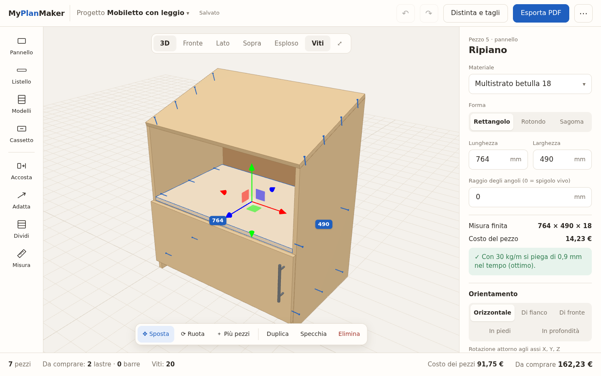
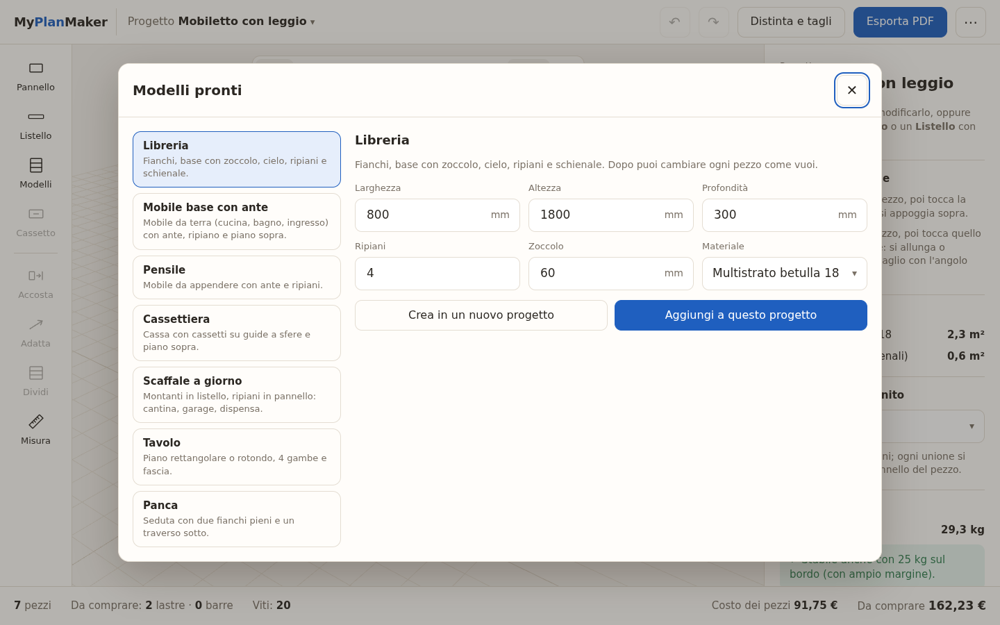
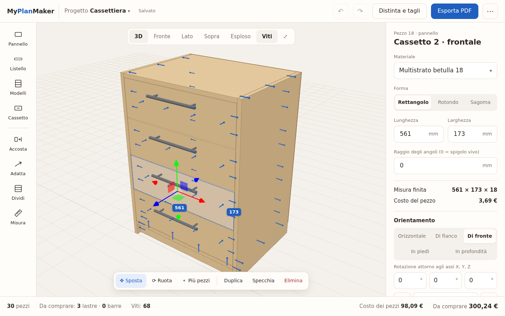
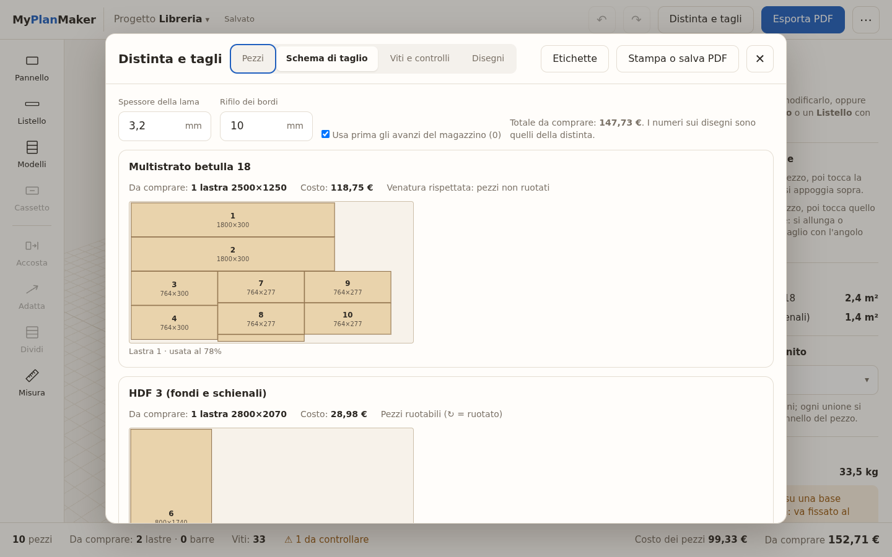
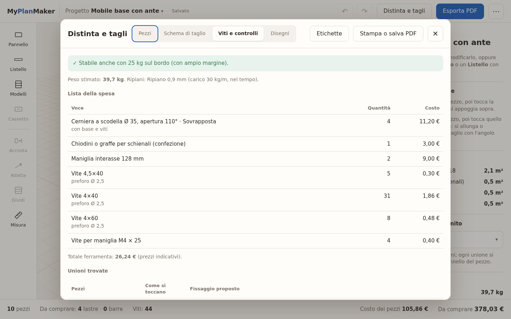
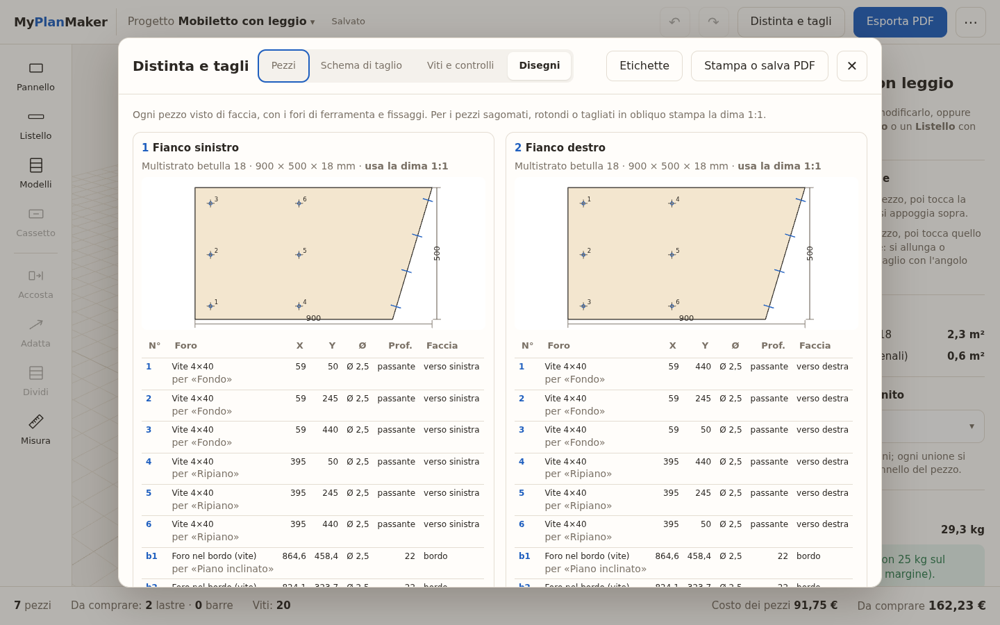
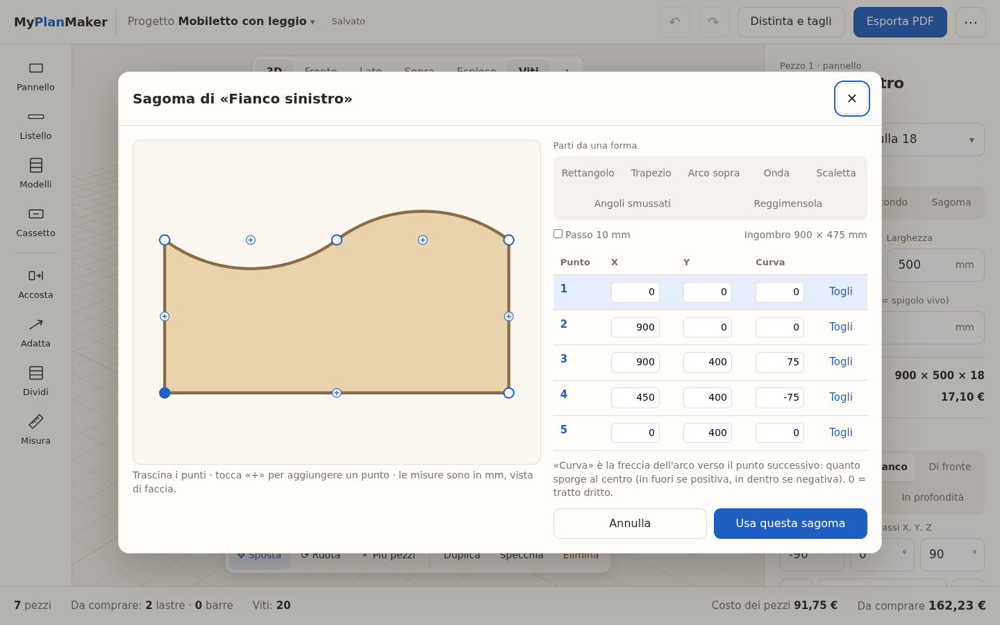
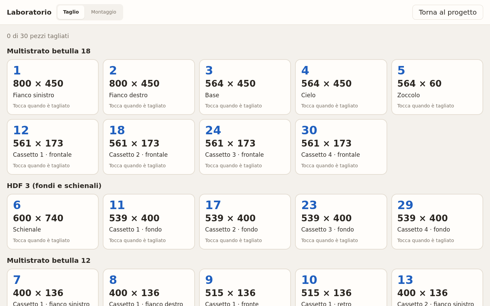
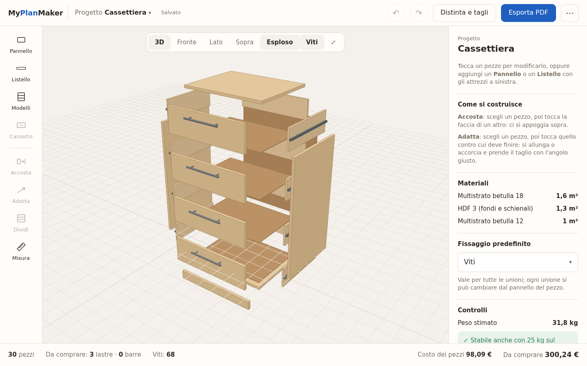

# MyPlanMaker

**Progettare mobili e costruzioni in legno come con un programma professionale, ma con un'interfaccia che si
capisce al primo sguardo.** Funziona nel browser su PC e tablet, anche senza rete, e gira sul tuo computer o sul
tuo server di casa: i progetti restano tuoi.



*[English](README.md) · Italiano* — l'interfaccia è in italiano, inglese, francese, tedesco e spagnolo.

## Cosa fa

**Si costruisce con pezzi veri.** Pannelli e listelli con gli spessori e le sezioni che compri davvero, a
qualunque angolo, anche curvi. Non è un CAD da imparare: le misure si scrivono a numero e i comandi sono pochi.

- **Modelli pronti** come punto di partenza: libreria, mobile base con ante, pensile, cassettiera, scaffale,
  tavolo (anche rotondo), panca. Misure e spessori si scelgono prima; dopo, ogni pezzo si cambia come
  se l'avessi fatto a mano.
- **Compositore di mobili a livelli**: zoccolo, cassetti, vani a giorno, ante, piano, con il disegno di fronte che
  si aggiorna mentre scrivi e una galleria di partenza; il mobile si può ricomporre dopo, dove sta.
- **Riempi un vano**: premi Riempi e tocca dentro il mobile: ripiani, divisori, schienale, ante (con cerniere e
  maniglie, coprenti o semicoprenti) o cassetti nascono già a misura di quel vano.
- **Sposta e ruota trascinando**, con passo di 5 mm e aggancio magnetico ai pezzi vicini; selezione multipla,
  copia specchiata, gruppi, scorciatoie da tastiera.
- **Disegno 2D** del pannello come in LightBurn: rettangoli, ellissi, poligoni e linee, ognuno pieno, foro passante
  o scasso; il pezzo è l'unione dei pieni meno i vuoti, con dima 1:1 e DXF (scassi su layer a parte).
- **Trascina** i pezzi direttamente nel 3D (come in Tinkercad). **Accosta** mette un pezzo, con la faccia che
  scegli, nel punto che tocchi su un altro; poi scrivi la distanza dai bordi o lo copi negli altri angoli.
  **Adatta** lo allunga o accorcia (anche in larghezza, anche ruotato) fino alla faccia che tocchi e lo taglia con
  l'angolo giusto (piani inclinati, tagli obliqui, lama inclinata). Spessori e sezioni si scrivono a mano; misure in mm o cm. **Dividi** mette N ripiani o
  divisori alla stessa distanza. **Cassetto** crea i cassetti tra due fianchi, con guide di misura commerciale.
- **Forme**: rettangoli con angoli arrotondati, cerchi, **sagome libere** con tratti dritti e ad arco (editor con
  punti da trascinare e forme di partenza).
- **Ferramenta**: cerniere a scodella (numero dall'altezza dell'anta, scodelle scavate nel pezzo), maniglie con
  interasse e posizione, guide per cassetti.
- **Fissaggi automatici**: dove due pezzi si toccano l'app propone viti (misura, quante, dove, preforo), oppure
  confirmat, spinotti, eccentrici o solo colla. Le viti negli angoli si spostano per non incontrarsi.
- **Controlli**: viti che si scontrano, pezzi che si compenetrano, ripiani che si piegano troppo (freccia nel
  tempo), mobili che si ribaltano se ci si appoggia, mobili alti da fissare al muro, peso.
- **Per il laboratorio**: distinta con misure finite e da tagliare (al netto dei bordi), **schema di taglio** su
  lastre e barre (lama, rifilo, venatura, magazzino avanzi), lista della spesa, **disegni quotati** di ogni pezzo
  con la tabella dei fori, **dime 1:1** su fogli A4, etichette, **istruzioni di montaggio**, **modalità
  laboratorio** per il tablet con i pezzi da spuntare.
- **Esportazioni**: PDF (stampa), CSV per i centri di taglio, DXF per CNC e laser, STL, PNG, file di progetto.
- **Basta lo spessore**: il tipo di legno è facoltativo (serve per colore, venatura e controlli più fini). Misure di lastre e barre, bordatura per lato, venatura per pezzo, versioni del
  progetto. **Prezzi e costi sono facoltativi**: si accendono dal menu ⋯.

| | |
|---|---|
|  |  |
| *Modelli pronti: poche misure e hai tutti i pezzi* | *Cassetti su guide, frontali a filo, maniglie* |
|  |  |
| *Schema di taglio sulle lastre, con la venatura* | *Lista della spesa e unioni trovate da sole* |
|  |  |
| *Disegni con i fori e la tabella delle quote* | *Sagome libere con archi* |
|  |  |
| *Modalità laboratorio per il tablet* | *Vista esplosa* |

## Provarlo

### Windows, senza installare niente
Scarica `MyPlanMaker-portable-<versione>.zip` dalla pagina *Releases*, scompattalo dove vuoi (anche su una
chiavetta) e fai doppio clic su `MyPlanMaker.bat`. Si apre in una finestra di Edge o Chrome; i progetti restano
nella cartella `dati`.

### Con Python (Linux, macOS, Windows)
Serve solo Python 3.10 o più recente, senza altre dipendenze:
```
python3 server/server.py
```
e apri `http://localhost:8099`.

### Con Docker (server di casa, NAS)
```
docker compose up -d
```
Porta 8099, dati nel volume `./data`. Variabili: `MPM_PORT`, `MPM_DATA`, `MPM_PASSWORD` (se impostata, la pagina
chiede la password).

Dal tablet: apri l'indirizzo del server e scegli «Aggiungi alla schermata Home» per usarla come un'app.

La lingua la prima volta segue quella del browser; si cambia dal menu ⋯ (IT, EN, FR, DE, ES).

## Come è fatto
- **Interfaccia**: JavaScript senza passaggi di compilazione (`web/`), 3D con [three.js](https://threejs.org),
  geometria dei solidi con [Manifold](https://github.com/elalish/manifold) (tagli, sagome, fori, compenetrazioni).
- **Lingue**: `web/js/lingua.js` e un dizionario per lingua in `web/js/lingue/`. I testi di partenza sono in
  italiano e fanno da chiave; `tests/test_lingue.py` controlla che ogni lingua abbia tutti i testi con gli stessi
  segnaposto.
- **Server**: Python con la sola libreria standard e SQLite (`server/server.py`), salva progetti e impostazioni.
  Ogni progetto ha anche una copia nel browser, quindi l'app funziona senza rete.
- **Prove**: `python3 -m unittest discover -s tests` per il server; con il server avviato, `/prove.html` esegue le
  prove di modello, geometria, viti, schema di taglio, modelli, disegni ed esportazioni (deve dire «TUTTE OK»).
- **Portable per Windows**: `sh windows/crea-portable.sh` crea lo zip con Python embeddable.

Le regole per viti, frecce e stabilità sono **indicative**: aiutano a non dimenticare niente, ma prima di forare
controlla sempre con la tua esperienza.

## Licenza
[MIT](LICENSE). Librerie incluse in `web/vendor/`: three.js (MIT), manifold-3d (Apache-2.0).
