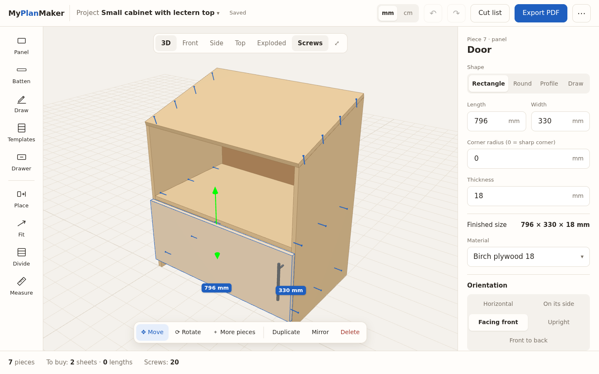
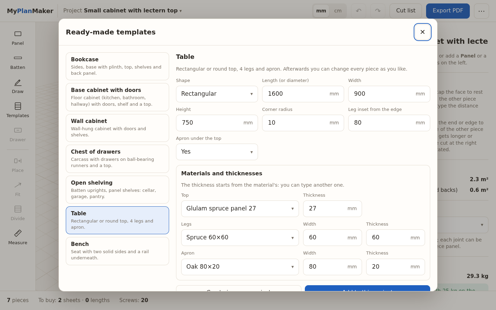
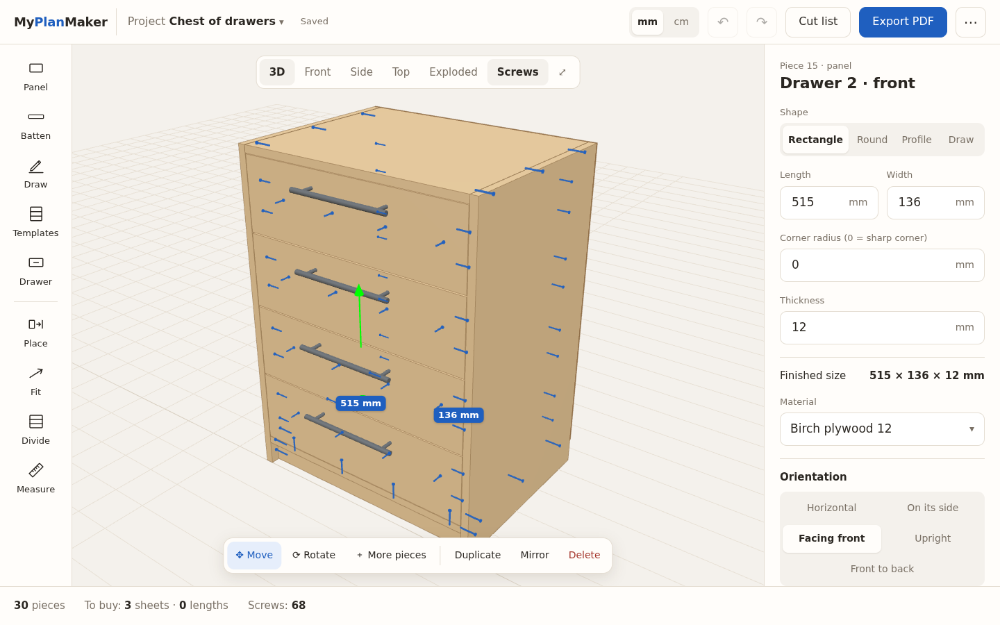
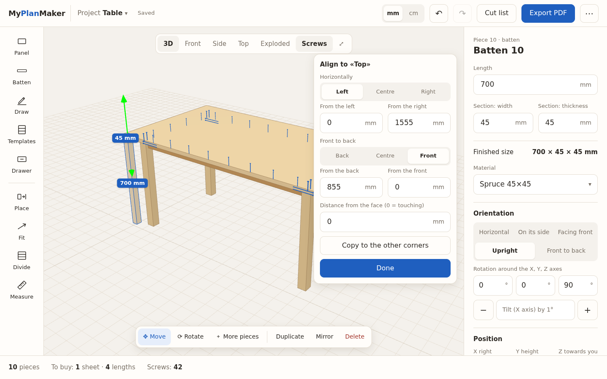
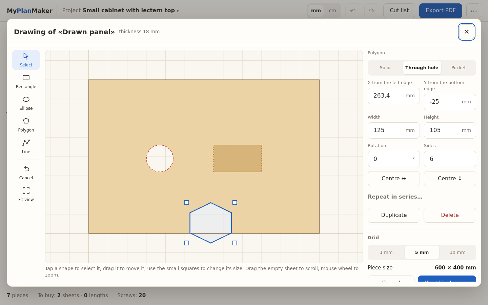
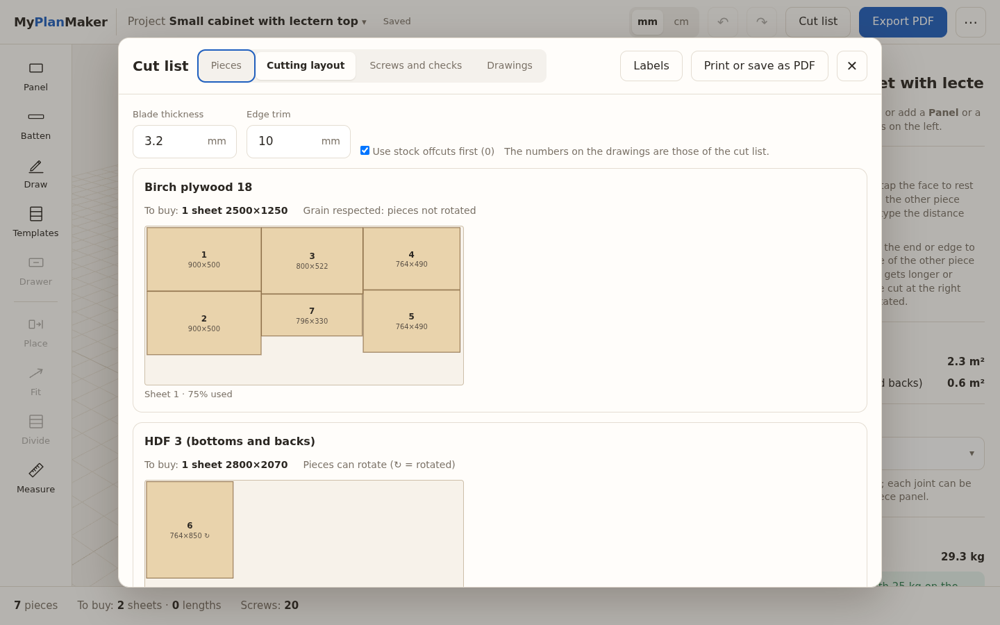
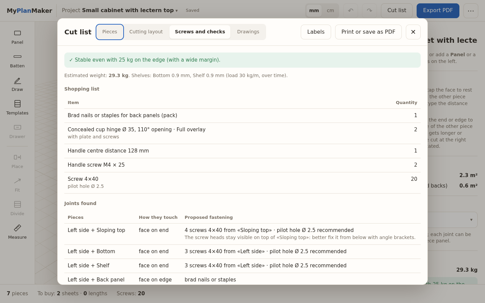
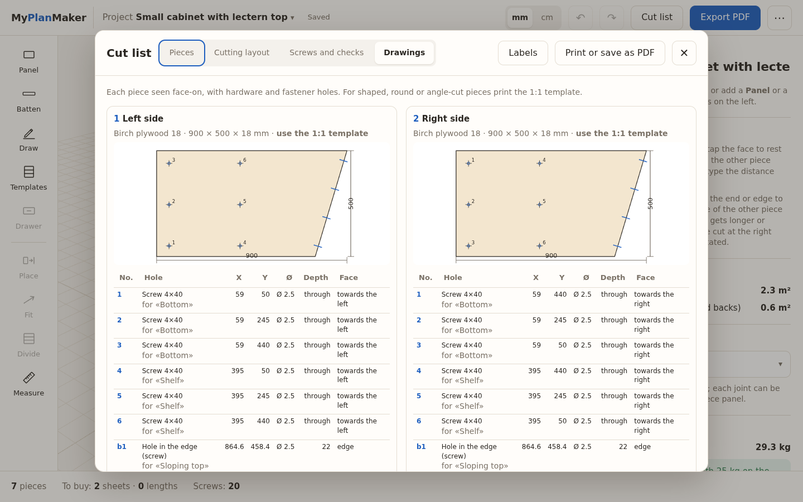
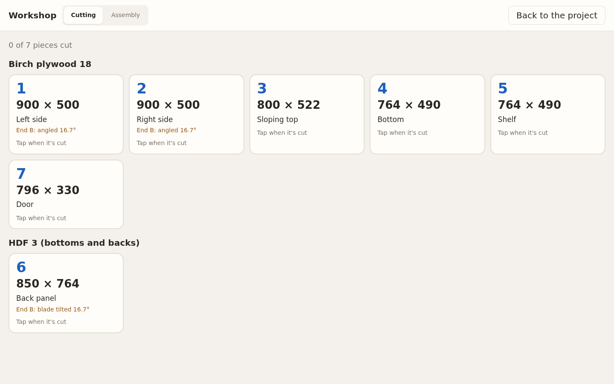

# MyPlanMaker

**Design furniture and woodwork like with professional software, with an interface you understand at first
glance.** It runs in the browser on PC and tablet, also offline, on your computer or your home server: your
projects stay yours.



*English · [Italiano](README.it.md)* — the interface is available in English, Italian, French, German and Spanish.

## What it does

**You build with real pieces.** Panels and battens with the thicknesses and sections you actually buy (or any
custom thickness), at any angle, also curved. It is not a CAD to learn: sizes are typed as numbers, in mm or cm,
and there are few commands.

- **Ready-made templates** as a starting point: bookcase, base cabinet with doors, wall cabinet, chest of drawers,
  open shelving, table (also round), bench. Every size and thickness can be changed, and afterwards each
  piece can be edited as if you had made it by hand.
- **Cabinet composer**: stack levels (plinth, drawers, open shelves, doors, top) with a live front view, from a
  gallery of starting points; the cabinet can be recomposed later, where it stands.
- **Fill an opening**: press Fill and tap inside a cabinet: shelves, dividers, a back panel, doors (with hinges and
  handles, full or half overlay) or drawers are added already cut to the size of that opening.
- **Drag pieces directly in 3D**, like in Tinkercad: 5 mm steps, magnetic snapping to nearby pieces, an arrow to
  raise or lower them. Multiple selection, mirrored copy, groups, keyboard shortcuts.
- **Place**: tap the face of a piece, then the point on another piece where it goes; then type the distance from
  the edges, align it (left, centre, right…) or copy it to the other corners — four table legs in a few taps.
- **Fit** extends or shortens a piece (in length or width, even when rotated) up to the face you tap and cuts it
  at the right angle: sloping tops, angled cuts, tilted blade. **Divide** spaces N shelves or dividers evenly.
  **Drawer** builds drawers between two sides with standard-length runners.
- **2D drawing** of a panel, as in LightBurn: rectangles, ellipses, polygons and point-to-point lines, each one
  solid, through hole or pocket with its depth. The piece is the union of the solids minus the holes, with snapping
  to the grid and to other shapes, typed positions, series of holes, 1:1 template and DXF (pockets on their own layer).
- **Shapes**: rectangles with rounded corners, circles, free **profiles** with straight and arc segments.
- **Hardware**: concealed cup hinges (number from the door height, cups cut into the piece), handles with centre
  distance and position, drawer runners.
- **Automatic fasteners**: where two pieces touch, the app proposes screws (size, how many, where, pilot hole), or
  confirmat, dowels, cam locks or glue only. Screws in corners are moved so they don't collide.
- **Checks**: colliding screws, overlapping pieces, shelves that sag too much over time, furniture that tips over
  when someone leans on it, tall units to fix to the wall, weight.
- **For the workshop**: cut list with finished and cutting sizes (net of edge banding), **cutting layout** on
  sheets and lengths (blade, trim, grain, offcut stock), shopping list, **dimensioned drawings** of every piece
  with the hole table, **1:1 templates** on A4 sheets, labels, **assembly instructions**, **workshop mode** for
  the tablet with pieces to tick off.
- **Exports**: PDF (print), CSV for cutting services, DXF for CNC and laser, STL, PNG, project file.
- **Thickness is enough**: the wood type is optional (for colour, grain and finer checks). Sheet and length sizes, edge banding per side, grain per piece, project versions.
  **Prices and costs are optional**: turn them on from the ⋯ menu if you want them.

| | |
|---|---|
|  |  |
| *Templates: a few sizes and thicknesses and you have all the pieces* | *Drawers on runners, flush fronts, handles* |
|  |  |
| *Place a leg under the top and type the distance from the edges* | *2D drawing with solid shapes, holes and pockets* |
|  |  |
| *Cutting layout on the sheets, respecting the grain* | *Shopping list and joints found automatically* |
|  |  |
| *Drawings with holes and the table of positions* | *Workshop mode for the tablet* |

## Try it

### Windows, without installing anything
Download `MyPlanMaker-portable-<version>.zip` from the *Releases* page, unzip it anywhere (even on a USB stick)
and double-click `MyPlanMaker.bat`. It opens in an Edge or Chrome window; projects stay in the `dati` folder.

### With Python (Linux, macOS, Windows)
Only Python 3.10 or newer is needed, with no other dependencies:
```
python3 server/server.py
```
then open `http://localhost:8099`.

### With Docker (home server, NAS)
```
docker compose up -d
```
Port 8099, data in the `./data` volume. Variables: `MPM_PORT`, `MPM_DATA`, `MPM_PASSWORD` (if set, the page asks
for the password).

On a tablet: open the server address and choose «Add to Home Screen» to use it like an app.

The language follows the browser the first time; you can change it from the ⋯ menu (IT, EN, FR, DE, ES).

## How it is made
- **Interface**: JavaScript with no build step (`web/`), 3D with [three.js](https://threejs.org), solid geometry
  with [Manifold](https://github.com/elalish/manifold) (cuts, profiles, 2D drawings, holes, interpenetration).
- **Languages**: `web/js/lingua.js` and one dictionary per language in `web/js/lingue/`. The source texts are in
  Italian and are the dictionary keys; `tests/test_lingue.py` checks that every language has every text, with the
  same placeholders.
- **Server**: Python with the standard library only and SQLite (`server/server.py`), stores projects and settings.
  Every project also has a copy in the browser, so the app works offline.
- **Tests**: `python3 -m unittest discover -s tests` for the server and the dictionaries; with the server running,
  `/prove.html` runs the model, geometry, screws, cutting layout, templates, drawings and export tests (it must
  say «TUTTE OK»). They run on GitHub at every push.
- **Portable for Windows**: `sh windows/crea-portable.sh` builds the zip with embeddable Python.

The source code (names and comments) and the design notes in `docs/PIANO.md` are in Italian.

The rules for screws, sag and stability are **indicative**: they help you not to forget anything, but always check
with your own experience before drilling.

## License
[MIT](LICENSE). Libraries included in `web/vendor/`: three.js (MIT), manifold-3d (Apache-2.0).
